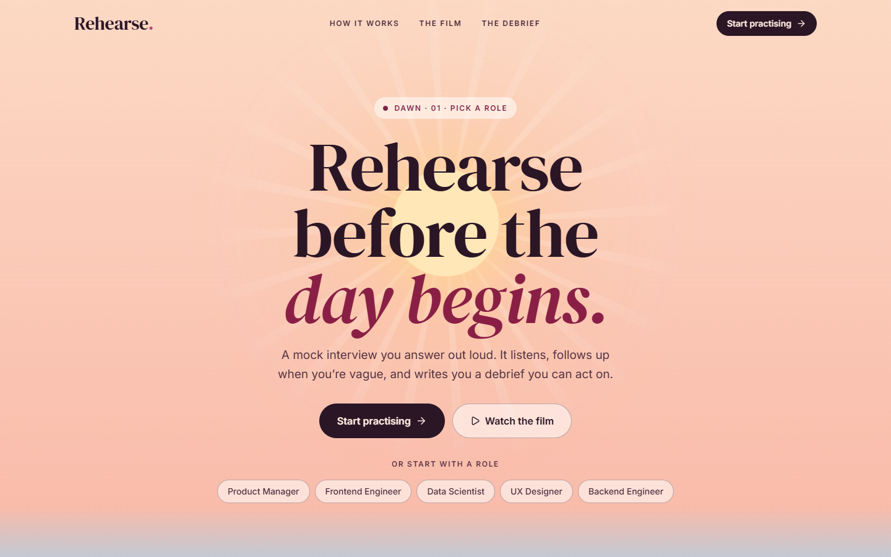
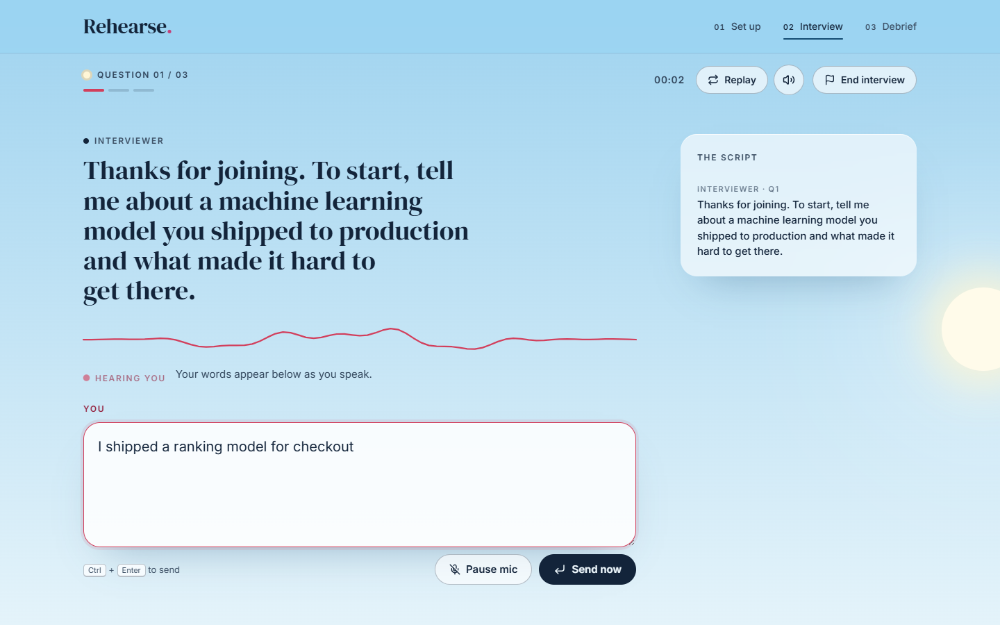
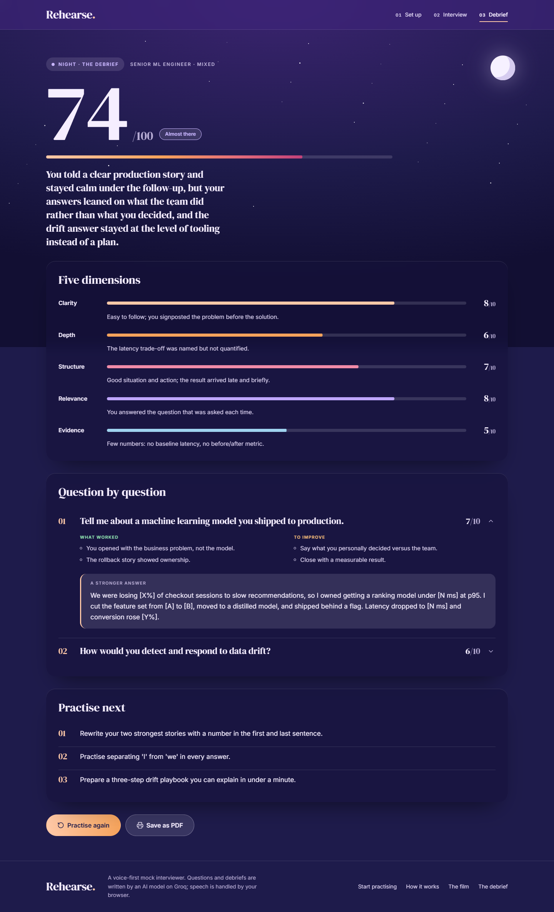
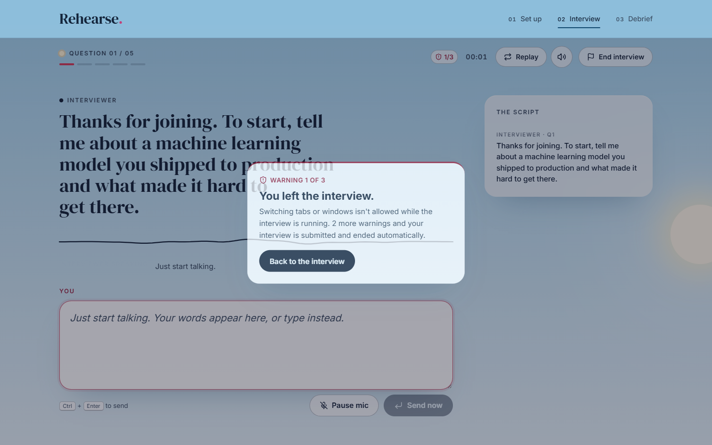

# Rehearse — AI mock interviewer

**Practise interviews out loud.** Pick a role, and an AI interviewer asks questions in a real voice, listens to your spoken answers, follows up when you're vague, and writes you a debrief you can act on.



## Features

- **Voice-first interview** — the interviewer speaks each question, the mic opens by itself, and your answer is sent after a short pause. You can type at any time instead.
- **Real follow-ups** — vague answers get probed, like in a real first round. The server keeps the interview on track and on time.
- **Tailored questions** — choose role, seniority, style (behavioral, technical or mixed), length, and optionally paste a job description.
- **Written debrief** — an overall score, five scored dimensions (Clarity, Depth, Structure, Relevance, Evidence), notes per question, a stronger version of each answer, and what to practise next. Exportable as PDF.
- **Proctoring** — leaving the tab gives a warning, and the third warning submits and ends the interview. Browser extensions are detected and blocked.
- **Works on restricted networks** — if the browser's speech service is unreachable, answers are recorded and transcribed on the server with Whisper.
- **Responsive and accessible** — keyboard friendly, screen-reader labels, reduced-motion support, phone to desktop.

| Interview | Debrief |
|---|---|
|  |  |

## Tech stack

| Layer | Tools |
|---|---|
| Frontend | React 19, Vite, Framer Motion, React Router, Lucide icons |
| Backend | FastAPI, httpx, Pydantic |
| AI | [Groq](https://console.groq.com): `openai/gpt-oss-120b` for the interviewer and debrief, `whisper-large-v3-turbo` for speech-to-text |
| Voice | Browser Web Speech API (speech recognition and synthesis), with a server-side Whisper fallback |

## Project structure

```
ai-mock-interviewer/
├── backend/            FastAPI service: interview state machine, Groq calls
│   ├── app/
│   │   ├── main.py     routes and error handling
│   │   ├── llm.py      Groq client: chat (JSON-checked) and transcription
│   │   ├── prompts.py  interviewer and debrief prompts
│   │   ├── schemas.py  request models and JSON schemas
│   │   └── store.py    sessions and per-IP limits (Upstash Redis or in memory)
│   └── check_key.py    verifies your Groq key and models
├── frontend/           React app
│   └── src/
│       ├── landing/    landing page (/)
│       ├── practice/   setup and mic test (/practice)
│       ├── interview/  live interview (/interview)
│       ├── report/     debrief (/report)
│       └── hooks/      speech, recording and extension detection
└── docs/               design notes and screenshots
```

## Getting started

### Prerequisites

- Python 3.10+
- Node.js 18+
- A free Groq API key from [console.groq.com/keys](https://console.groq.com/keys)

### 1. Backend

```bash
cd backend
python -m venv .venv
.venv\Scripts\activate            # macOS/Linux: source .venv/bin/activate
pip install -r requirements.txt
copy .env.example .env            # macOS/Linux: cp .env.example .env
```

Put your key in `backend/.env` as `GROQ_API_KEY=...`, then:

```bash
python check_key.py               # checks the key and lists the models it can use
uvicorn app.main:app --reload --reload-include .env --port 8001
```

### 2. Frontend

```bash
cd frontend
npm install
copy .env.example .env            # macOS/Linux: cp .env.example .env
npm run dev
```

Open **http://localhost:5173**. Use Chrome or Edge for the best voice support; other browsers can type their answers.

## How it works

1. **Setup** — you choose the interview settings and can test your mic.
2. **Interview** — the backend holds the conversation and tracks state (current question, follow-ups). Each model reply is JSON (`reply` plus `action`: `question`, `follow_up` or `wrap_up`), checked against a schema and retried if invalid. The server caps follow-ups and questions so the interview always ends on time.
3. **Debrief** — the full transcript is scored against the rubric and returned as schema-checked JSON, so the UI always receives valid data.

### Proctoring



- Switching tabs or windows during the interview shows a warning (1 of 3, 2 of 3).
- The third warning automatically submits the answer in progress and ends the interview.
- The interview otherwise ends only when it's **completed** or the candidate **submits** it. Reload and close ask for confirmation, and the back button is held off.
- The setup page won't start while a browser extension is detected, and an extension that appears mid-interview counts as a warning.

> A web page can't list installed extensions, so detection covers extensions that change the page (writing assistants, AI sidebars, translators, dark-mode tools). All checks run in the browser: they discourage cheating rather than make it impossible.

## API

| Method | Path | Purpose |
|---|---|---|
| `POST` | `/api/sessions` | Start an interview; returns the first question |
| `POST` | `/api/sessions/{id}/answer` | Send an answer; returns the next question, follow-up or closing |
| `POST` | `/api/sessions/{id}/end` | Submit and end the interview (optionally with the answer in progress) |
| `POST` | `/api/sessions/{id}/report` | Generate, or fetch the cached, debrief |
| `POST` | `/api/transcribe` | Speech-to-text fallback (WAV audio in, text out) |
| `GET`  | `/api/health` | Health check |

## Configuration

Backend settings live in `backend/.env` (see [`backend/.env.example`](backend/.env.example)):

| Variable | Default | Description |
|---|---|---|
| `GROQ_API_KEY` | — | Your Groq API key (required) |
| `GROQ_MODEL` | `openai/gpt-oss-120b` | Model for the interviewer and debrief |
| `GROQ_TRANSCRIBE_MODEL` | `whisper-large-v3-turbo` | Speech-to-text model |
| `ALLOWED_ORIGINS` | `http://localhost:5173` | Comma-separated frontend origins |
| `MAX_SESSIONS_PER_IP_PER_DAY` | `15` | Limits interviews per visitor |
| `UPSTASH_REDIS_REST_URL` / `UPSTASH_REDIS_REST_TOKEN` | empty | Upstash Redis for sessions (or `KV_REST_API_URL` / `KV_REST_API_TOKEN`). Empty = in memory |
| `TURN_REASONING` / `REPORT_REASONING` | `low` / `medium` | Reasoning effort per call type |

The frontend needs only `VITE_API_URL` in `frontend/.env`, the backend URL (locally `http://localhost:8001`). When it's empty in a production build, the app calls `/api` on its own domain.

## Deployment

### Vercel (one project, recommended)

The root [`vercel.json`](vercel.json) deploys both parts as one Vercel project with two services: `backend` (FastAPI) serves `/api/*`, and `frontend` (Vite) serves everything else, on the same domain.

1. Import the repository in Vercel. It picks up `vercel.json`.
2. Add **Upstash Redis** from the Vercel Marketplace (free tier) and connect it to the project. It sets `KV_REST_API_URL` and `KV_REST_API_TOKEN`, which the backend uses for sessions. Serverless instances don't share memory, so this is required.
3. Add the environment variable `GROQ_API_KEY`. Don't set `VITE_API_URL` or `ALLOWED_ORIGINS`: frontend and API share one domain.
4. Deploy, then open `/api/health`. It should show `"groq": true` and `"sessions": "redis"`.

### Separate hosts

- **Backend (Render or Railway):** root `backend/`, start command `uvicorn app.main:app --host 0.0.0.0 --port $PORT`. Set `GROQ_API_KEY` and `ALLOWED_ORIGINS=https://your-frontend-domain`. One long-running server can keep sessions in memory, so Redis is optional.
- **Frontend (Vercel or Netlify):** root `frontend/`, build `npm run build`, output `dist/`. Set `VITE_API_URL` to your backend URL. SPA rewrites are already included (`vercel.json`, `public/_redirects`).

Every visitor uses your Groq key's free-tier limits, so keep the per-IP cap on for a public demo.

## Notes

- Sessions are kept in Upstash Redis when it's configured (they expire after 2 hours), and otherwise in memory, which is fine locally or on a single server.
- The API key stays on the server; the browser never sees it.
- Groq rate limits are retried automatically. Groq's free tier also has per-day limits, shown in the Groq console.
- The design direction is documented in [docs/DESIGN.md](docs/DESIGN.md).
